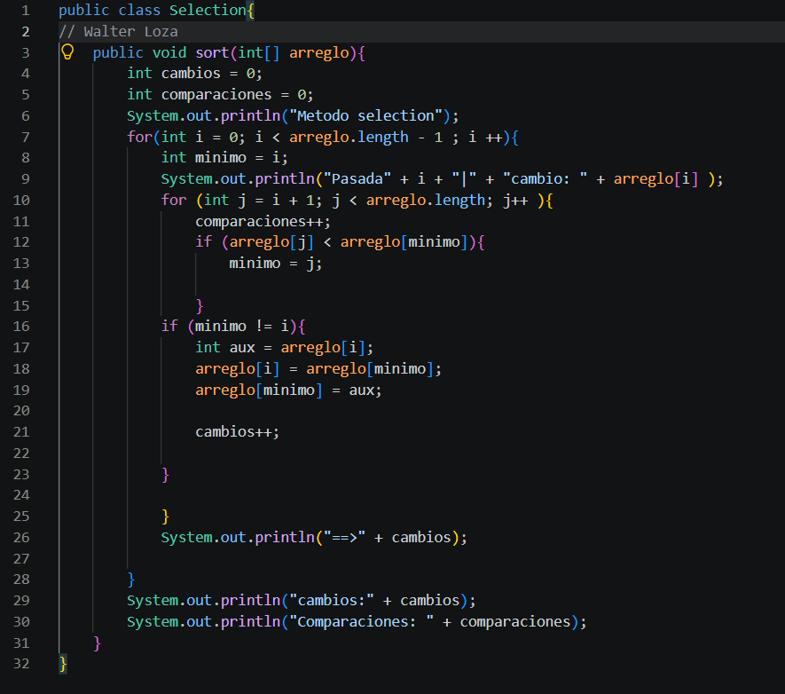
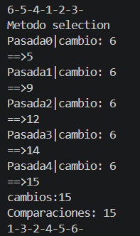

Metodo Selecion

Resultado

COMENTARIO  

Lo principal fue entender como funciona el algoritmo de selecion que va comparando y guarda en un auxilar el menor de todo el arreglo y el menor lo va ubicando en horden de izquierda a derecha. El sout para contar ls conbinaciones y cambios estan en el primer for y va mostrando la pasada i y el arreglo[i]. 
